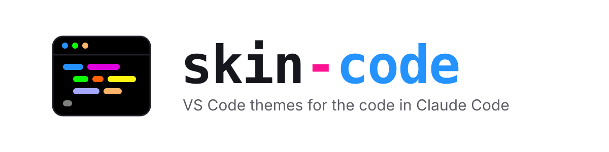

<h1 align="center">
	<picture>
		<source media="(prefers-color-scheme: dark)" srcset="docs/brand/banner-dark.svg">
		
	</picture>
</h1>

Real syntax highlighting for code blocks in Claude Code replies. skin-code highlights each fenced block with **VS Code's own grammars** through [Shiki](https://shiki.style) and colours it with **VS Code themes**, so code in Claude Code looks the way it does in your editor.

- 29 themes, dark and light, including [Neon Bunny](https://github.com/webdevnerdstuff/neon-bunny-vscode-theme) and Neon Bunny Carrot, plus any VS Code theme you add
- 39 languages, with PHP, Blade, Vue, TypeScript and JavaScript first among them
- Follows the [skins](https://github.com/hellosverre/claude-skins) mod when it is installed: change your skin and the code colours follow, light or dark
- In the desktop app and the terminal, with line numbers, the language and a copy button

## Install

In a Claude Code terminal session:

```bash
/plugin install skin-code --marketplace webdevnerdstuff/claude-skin-code
```

Answer `y` to add the marketplace, then pick a scope (user scope loads it in every session, the desktop app's included).

Needs Claude Code 2.1.287 or newer. skins is optional; with it, use skins 0.5.8 or newer.

### Update and remove

To update, refresh the marketplace, then update the plugin and restart Claude Code:

```bash
claude plugin marketplace update claude-skin-code
claude plugin update skin-code@claude-skin-code
```

To remove it:

```bash
claude plugin uninstall skin-code@claude-skin-code
```

## Use

| Command | What it does |
| --- | --- |
| `/skin-code` or `/skin-code status` | Shows what everything is set to |
| `/skin-code auto` | Follows your skins skin, light or dark (the default) |
| `/skin-code <skin>` | A skin's dark and light themes, e.g. `/skin-code catppuccin` |
| `/skin-code <theme>` | One theme, always, e.g. `/skin-code github-dark` |
| `/skin-code off` | Leaves code blocks to skins or the app |
| `/skin-code list` or `/skin-code themes` | Every skin and theme |
| `/skin-code add <url or path>` | Adds a VS Code theme `.json` |
| `/skin-code remove <name>` | Removes a theme you added |
| `/skin-code header on\|off` | The bar with the language and line count |
| `/skin-code numbers on\|off` | The line numbers |
| `/skin-code style text\|card` | Desktop blocks as selectable text (the default), or as a card in the code font |
| `/skin-code help` | Lists the commands |

Your settings and the themes you add are kept across sessions. Without skins, `auto` draws Neon Bunny; set `SKIN_CODE_THEME=light` or `dark` to pick the lightness yourself.

## Add your own theme

Any VS Code color theme works: the `.json` file a theme extension ships in its `themes/` folder. A GitHub file link or a local path both work, and skin-code switches to the theme once it is added:

```bash
/skin-code add https://github.com/you/your-theme/blob/main/themes/your-theme.json
```

## For mod authors

Other mods can add themes and leave replies to skin-code through `$.skinCode`; the API is in [`types/index.d.ts`](types/index.d.ts).

## Develop

```bash
pnpm build  # bundles Shiki, the grammars and the themes into hooks/vendor
pnpm check  # validates and tests
```

Load it from the folder while you work on it: `claude --plugin-dir .`. To add a theme or a language to the bundle, see [AGENTS.md](AGENTS.md).

## Credits

- [Shiki](https://shiki.style) and the TextMate grammars and themes it bundles
- [skins](https://github.com/hellosverre/claude-skins) by hellosverre, which skin-code follows and draws prose through
- Neon Bunny themes by [WebDevNerdStuff](https://github.com/webdevnerdstuff/neon-bunny-vscode-theme)

## License

MIT © WebDevNerdStuff. The bundled Shiki code, grammars and themes keep their own licences: see [THIRD_PARTY_NOTICES.md](THIRD_PARTY_NOTICES.md).
